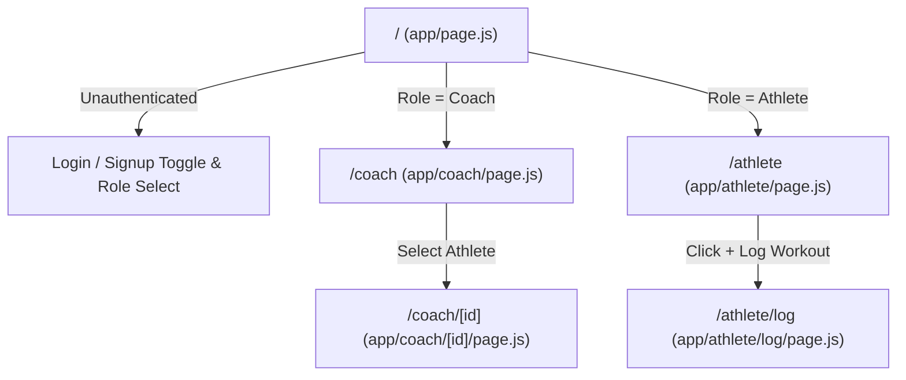
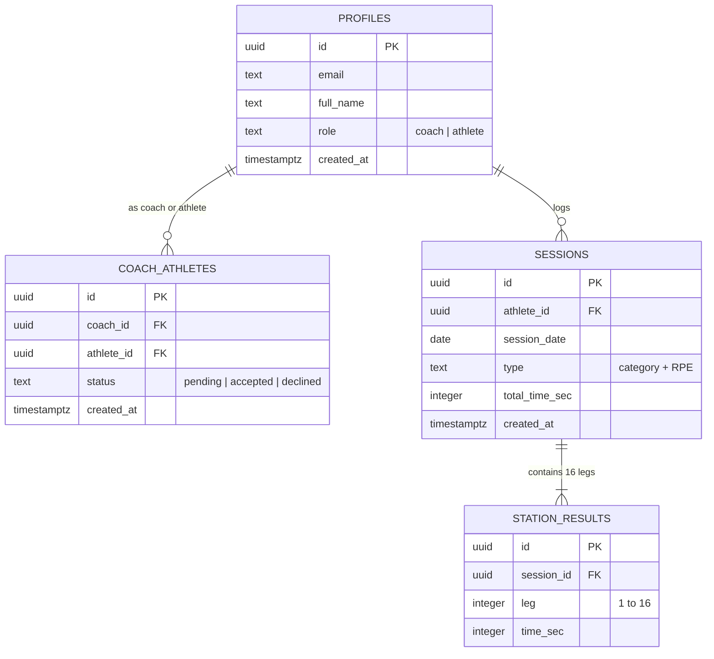

# RŌXCOACH — Product UX, Frontend & Backend Architecture Review Document

> **Document Purpose:** This architectural review document is structured for Senior Product Managers, Principal UX Designers, and Staff Database Architects (ChatGPT & Claude) to audit the RŌXCOACH platform codebase, UX decisions, and PostgreSQL/Supabase schema.

---

## Executive Summary & Product Positioning

* **Product Name:** RŌXCOACH — The HYROX Coaching Operating System
* **Commercial Model:** B2B SaaS for certified and independent HYROX coaches.
* **Core Value Proposition:** High-leverage athlete portfolio management, 8-station compromised pacing intelligence, and quantified training deltas (transitioning coaching from subjective guesswork to race-day engineering).
* **Live Production URL:** [https://hyrox-tracker-peach.vercel.app](https://hyrox-tracker-peach.vercel.app)
* **Repository:** `deyuranm123/hyrox-tracker` (Branch: `main`)
* **Local Workspace Storage:** `/Volumes/HIKSEMI/Antigravity Projects/hyrox-tracker`

---

## 1. Product UX & Design System Architecture

### 1.1 Dual-Persona Asymmetric Architecture
Rather than forcing coaches and athletes through identical responsive layouts, RŌXCOACH enforces distinct interaction paradigms:

| Metric / Dimension | Coach Experience | Athlete Experience |
| :--- | :--- | :--- |
| **Primary Device** | **Desktop-First Command Centre** | **Mobile-First Training Companion** |
| **Cognitive Goal** | High-density portfolio overview, triage, and risk detection. | Sub-60 second frictionless split logging and compliance. |
| **Core Interaction** | Answering the 5 coaching questions; drilling into station deltas. | Tapping numeric keypad for 16 splits + RPE recording. |
| **Key Metric** | Athlete compliance rate, attention signals, and station deltas. | Personal Best (PB), elapsed session time, and running pace. |

---

### 1.2 The 5-Question Coach Command Centre
The coach dashboard (`app/coach/page.js`) is architected around 5 immediate cognitive triggers:
1. **How many athletes am I managing?** $\rightarrow$ Active vs. Pending Onboarding KPI card.
2. **Who needs my attention right now?** $\rightarrow$ **Attention Required Panel** flagging:
   - Inactive athletes ($>7$ days without logged training).
   - Pending roster invitations.
   - Positive delta breakthroughs ($\Delta$ improvements).
3. **Which athletes are improving?** $\rightarrow$ Roster table with live signed deltas (e.g. `−0:18` in green).
4. **Who is falling behind or missing sessions?** $\rightarrow$ Inactivity alerts with days-elapsed counters.
5. **What do I need to do today?** $\rightarrow$ One-click roster invitations and scorecard inspections.

---

### 1.3 Design System Tokens (`app/globals.css`)
RŌXCOACH discards generic light themes and black buttons in favor of an elite sports-tech visual identity:

```css
:root {
  /* Brand Canvas & Elevation */
  --bg-navy: #101A2B;          /* Deep athletic canvas */
  --surface-card: #17263B;     /* Base card elevation */
  --surface-elevated: #1E314B; /* Interactive table rows & hover states */
  --border-subtle: #22354E;    /* Clean contrast separators */

  /* High-Performance Accents */
  --teal-primary: #19B6A0;     /* Primary brand action & progress */
  --teal-glow: rgba(25, 182, 160, 0.18);
  --gold-hyrox: #F59E0B;       /* HYROX race mark, PBs, attention badges */
  --danger-coral: #EF4444;     /* Inactivity, regression, destructive actions */
  --success-emerald: #10B981;  /* Personal bests & speed improvements */

  /* Typography Hierarchy */
  --text-primary: #E8EDF4;     /* High-legibility ice white */
  --text-muted: #8E9CAE;       /* Secondary labels & metadata */
  --text-subtle: #5F7085;      /* Subtext & leg indicators */
}
```

---

## 2. Frontend Application Architecture

### 2.1 Technology Stack
* **Framework:** Next.js 14.2 (App Router)
* **Runtime:** Node.js v24 / React 18
* **Styling:** Custom CSS Design Tokens (`app/globals.css`) with zero layout shift and lightweight footprint ($<88\text{ KB}$ first load JS).
* **State Management:** Reactive hooks + optimistic local UI state synced with Supabase Realtime sessions.

### 2.2 Screen Hierarchy & Routing



#### Detailed Route Specifications:
1. **`/` (`app/page.js`):**
   - Unauthenticated landing with RŌXCOACH positioning.
   - Dual-mode form (Sign In vs. Create Account).
   - Role selector with distinct onboarding context:
     - `coach` $\rightarrow$ HYROX Coach Command Centre
     - `athlete` $\rightarrow$ HYROX Athlete Training Companion
   - Session listener that routes existing tokens instantly without flash-of-unauthenticated-content.

2. **`/coach` (`app/coach/page.js`):**
   - Top KPI Ribbon (Active Athletes, Attention Signals, Weekly Pace, Readiness).
   - Actionable "Attention Required" list.
   - Roster table displaying Athlete Name, Email, Status (`Active` vs. `Awaiting Acceptance`), Last Session Date, Total Time, and Recent $\Delta$ (signed time difference).
   - Security-definer athlete invitation input.

3. **`/coach/[id]` (`app/coach/[id]/page.js`):**
   - Athlete Profile Header with Personal Best and Total Simulations Completed.
   - **8-Station Scorecard Grid:** Real-time breakdown of SkiErg, Sled Push, Sled Pull, Burpees, Rowing, Farmers Carry, Sandbag Lunges, and Wall Balls with per-station deltas against the athlete's prior simulation.
   - **Running Engine Analytics:** Total 8km Run Time and Average Compromised Pace (`m:ss/km`).
   - **Primary Focus Area Detection:** Automatically flags the single station causing the highest time drain.
   - Chronological Progression Trend table.
   - Full 16-leg split inspectable accordion.

4. **`/athlete` (`app/athlete/page.js`):**
   - Prominent incoming coach connection approval banner (one-click Accept/Decline).
   - Personal Best summary card.
   - Prominent `+ Log New Workout (<60s)` action button.
   - Accordion list of all completed simulations with running pace and station splits.

5. **`/athlete/log` (`app/athlete/log/page.js`):**
   - Rapid 16-leg input grid with `inputMode="numeric"`.
   - **Live Elapsed Calculation Engine:** Automatically recalculates total elapsed time, 8km run time, and station total while typing.
   - Rate of Perceived Exertion (RPE 6 to 10 scale).
   - Category tag: *Training Simulation*, *Official Race Benchmark*, or *Taper Rehearsal*.

---

## 3. Backend & Database Architecture (Supabase / PostgreSQL)

### 3.1 Entity Relationship Diagram



---

### 3.2 Row-Level Security (RLS) Policy Matrix

| Table | Operation | Target Role | Policy Rule |
| :--- | :--- | :--- | :--- |
| `profiles` | `SELECT` | Self | `id = auth.uid()` |
| `profiles` | `SELECT` | Linked Coach/Athlete | Permitted if an entry in `coach_athletes` links `coach_id` and `athlete_id`. Allows mutual visibility for invitations. |
| `coach_athletes` | `SELECT` | Both | `coach_id = auth.uid() OR athlete_id = auth.uid()` |
| `coach_athletes` | `INSERT` | Coach | `coach_id = auth.uid()` |
| `coach_athletes` | `UPDATE` | Athlete | `athlete_id = auth.uid()` (Accept/Decline rights) |
| `sessions` | `SELECT` | Athlete | `athlete_id = auth.uid()` |
| `sessions` | `SELECT` | Coach | **Strict Privacy Enforcement:** `athlete_id IN (SELECT athlete_id FROM coach_athletes WHERE coach_id = auth.uid() AND status = 'accepted')` |
| `station_results`| `SELECT` | Coach/Athlete | Inherits parent session access permissions. |

---

### 3.3 Critical PostgreSQL Procedures

#### 1. Security-Definer Roster Invitation (`request_athlete`)
Prevents exposing the entire user table to coaches:
```sql
create or replace function public.request_athlete(p_email text)
returns text language plpgsql security definer as $$
declare
  v_coach_id uuid := auth.uid();
  v_athlete_id uuid;
  v_role text;
begin
  select role into v_role from public.profiles where id = v_coach_id;
  if v_role != 'coach' then return 'not_allowed'; end if;

  select id into v_athlete_id from public.profiles 
  where lower(email) = lower(trim(p_email)) and role = 'athlete';
  if v_athlete_id is null then return 'not_found'; end if;

  insert into public.coach_athletes (coach_id, athlete_id, status)
  values (v_coach_id, v_athlete_id, 'pending')
  on conflict (coach_id, athlete_id) do nothing;

  return 'requested';
end;
$$;
```

#### 2. Auth Trigger Synchronization (`handle_new_user`)
Guarantees profile generation upon Supabase `auth.users` creation, resolving the `full_name` vs `name` schema discrepancy with fallback:
```sql
create or replace function public.handle_new_user()
returns trigger language plpgsql security definer as $$
begin
  insert into public.profiles (id, email, full_name, role)
  values (
    new.id,
    coalesce(new.email, new.raw_user_meta_data->>'email', ''),
    coalesce(new.raw_user_meta_data->>'full_name', new.raw_user_meta_data->>'name', 'Athlete'),
    coalesce(new.raw_user_meta_data->>'role', 'athlete')
  )
  on conflict (id) do update set
    full_name = excluded.full_name,
    role = excluded.role;
  return new;
end;
$$;
```

---

## 4. Performance & Algorithm Engine (`lib/performance.js`)

The platform's core algorithmic advantage lies in transforming raw split times into actionable coaching intelligence:

### 1. 8-Station Compromised Pacing Analysis
Computes individual station efficiency deltas:
$$\Delta_{\text{station}} = \text{Time}_{\text{current}} - \text{Time}_{\text{benchmark}}$$
A negative $\Delta$ denotes a speed improvement under fatigue.

### 2. Compromised Running Engine Decay
Calculates running splits specifically across odd legs ($1, 3, 5, 7, 9, 11, 13, 15$):
$$\text{Average Pace} = \frac{\sum_{i=1}^{8} \text{Run}_i}{8\text{ km}}$$
Allows coaches to pinpoint after which workout station the athlete's aerobic engine begins to deteriorate.

### 3. Station Weakness Identification
Scans the 8 workout stations to detect the largest relative time drain during the simulation.

---

## 5. Review Prompts for ChatGPT & Claude

When providing this document to ChatGPT or Claude for evaluation, use the following prompts:

### Prompt for Senior Product UX Specialist:
> *"Review this RŌXCOACH architecture from the perspective of a B2B SaaS Senior Product Designer. Evaluate: (1) Does the asymmetric coach desktop command centre vs athlete mobile companion meet the real workflow of fitness coaches? (2) Does the 'Attention Required' panel provide sufficient actionability? (3) What micro-interactions or dashboard components should be prioritized in Phase 2 for training programme scheduling?"*

### Prompt for Principal Full-Stack / Database Architect:
> *"Review the PostgreSQL schema, Row-Level Security policies, and Next.js 14 frontend architecture for RŌXCOACH. Evaluate: (1) Are there any RLS security vulnerabilities or data leakage vectors between coaches and athletes? (2) Is the performance calculation engine efficient for scaling to hundreds of logged simulations per athlete? (3) What schema additions do you recommend for Phase 2 (Weekly Programme Builder & Prescribed vs. Completed Workouts)?"*
