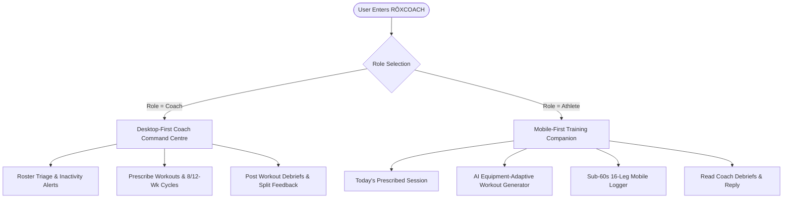

# RŌXCOACH — Complete Product, UX & Design Review Specification
*For Product Designers, UX Researchers, and Design System Leads*

> **Document Type:** Full Product & Design System Audit  
> **Application:** RŌXCOACH (The HYROX Coaching Operating System)  
> **Repository:** `deyuranm123/hyrox-tracker` | **Branch:** `main`  
> **Live Production URL:** [https://hyrox-tracker-peach.vercel.app](https://hyrox-tracker-peach.vercel.app)  
> **Local Workspace:** `/Volumes/HIKSEMI/Antigravity Projects/hyrox-tracker`  
> **Tech Stack:** Next.js 14 App Router, React 18, Supabase (PostgreSQL 15 + RLS), Zero-Runtime Pure CSS Tokens

---

## 1. Product Proposition & Persona Architecture

### 1.1 Commercial Proposition
RŌXCOACH is a specialized B2B SaaS platform for certified and independent HYROX coaches, and an intelligent training companion for individual HYROX athletes.

Unlike generic workout trackers (Strava, Nike Training Club, Apple Fitness), RŌXCOACH solves two specific sport-specific challenges:
1. **The Coaching Circuit:** Coaches need to prescribe structured simulations, track athlete training compliance, monitor station speed deltas ($\Delta$), and debrief race performance.
2. **The Equipment Barrier ("Prepare for HYROX Anywhere"):** Official HYROX races require specialized equipment (SkiErgs, Sled Push/Pull turf tracks, Concept2 rowers, 100-rep wall ball targets, 20–30kg sandbags). RŌXCOACH mathematically calculates biomechanical substitutions based on whatever equipment an athlete actually possesses (e.g. treadmill incline marches, weighted bear crawls, resistance band pulls).

---

### 1.2 Dual-Persona Asymmetric Architecture



| Dimension | Coach Experience (Desktop-First) | Athlete Experience (Mobile-First) |
| :--- | :--- | :--- |
| **Primary Context** | Laptop / Tablet in gym office or home desk. | Smartphone on the gym floor, turf track, or garage. |
| **Cognitive Goal** | High-density portfolio triage, risk detection, weekly planning. | Frictionless split logging ($<60\text{s}$), starting today's session. |
| **Core Interaction** | Answering the 5 coaching questions; prescribing workouts; debriefing. | Tapping numeric keypad for 16 splits; swapping substituted exercises. |
| **Key Metrics** | Roster Compliance %, Station Deltas ($\Delta$), Inactivity warnings. | Personal Best (PB), Target vs Actual Time, Running Pace ($/km$). |

---

## 2. Design System & Visual Identity Tokens (`app/globals.css`)

RŌXCOACH discards generic light themes in favor of an elite, dark athletic sports-tech visual identity:

### 2.1 Color Palette & Semantic Tokens
```css
:root {
  /* Canvas & Elevated Surfaces */
  --bg-navy: #101a2b;          /* Primary deep athletic canvas */
  --surface-card: #17263b;     /* Base card elevation */
  --surface-elevated: #1e314b; /* Interactive table rows & timeline steps */
  --surface-hover: #233a59;    /* Hover accent */
  --border-subtle: #22354e;    /* Clean hairline divider */
  --border-active: #2f496b;    /* Focused inputs & active cards */

  /* High-Performance Accents */
  --teal-primary: #19b6a0;     /* Primary brand action, coach badge, high transfer */
  --teal-glow: rgba(25, 182, 160, 0.18);
  --gold-hyrox: #f59e0b;       /* Official HYROX mark, PBs, prescriptions, deloads */
  --gold-glow: rgba(245, 158, 11, 0.15);
  --danger-coral: #ef4444;     /* Inactivity alerts, slower deltas, validation errors */
  --success-emerald: #10b981;  /* Completed sessions, faster deltas, direct equivalents */

  /* Typography Hierarchy */
  --text-primary: #e8edf4;     /* High-legibility crisp ice white */
  --text-muted: #8e9cae;       /* Secondary metadata & labels */
  --text-subtle: #5f7085;      /* Split indices & leg indicators */
}
```

### 2.2 Micro-Components & Badges
* **`.transfer-badge`:** Pill component denoting biomechanical transfer quality:
  - `transfer-direct` (Emerald): 100% Direct race equivalent.
  - `transfer-high` (Teal): 80–99% High transfer (same biomechanical pattern & energy system).
  - `transfer-moderate` (Gold): 65–79% Conditioning equivalent.
  - `transfer-general` (Slate): General aerobic/muscular stimulus.
* **`.chip` & `.chip-group`:** Mobile-optimized touch chips with tactile feedback for equipment and objective selection.
* **`.scorecard-item`:** High-density telemetry cards displaying official station names, formatted splits, and signed performance deltas.

---

## 3. Screen-by-Screen UX & Information Architecture

The application contains **12 production routes** currently live and deployed:

```
RŌXCOACH Route Manifest
├── /                                    (Landing & Dual-Persona Auth Router)
├── /athlete                             (Athlete Dashboard, Today's Session & Debriefs)
│   ├── /athlete/log                     (Sub-60s 16-Leg Workout Logger)
│   ├── /athlete/equipment               (Equipment Inventory & Station Coverage Audit)
│   ├── /athlete/workouts/generate       ("Build My HYROX Workout" Adaptive Generator)
│   └── /athlete/programmes              (Periodized Training Roadmap & Enrollment)
└── /coach                               (Coach Command Centre & Roster Triage)
    ├── /coach/[id]                      (Athlete Scorecard, Prescriptions & Debrief Modal)
    └── /coach/programmes                (12-Week Periodized Cycle Designer)
```

---

### Screen 1: Landing & Auth Router (`/` -> `app/page.js`)
* **Visual Purpose:** Instant conversion with clear trust signals.
* **Hero Copy:** *"Log every split. Know where you lose time."*
* **Role Toggle:** Segmented two-button toggle: **"I'm an Athlete"** vs **"I'm a Coach"** (replaces legacy dropdowns).
* **Privacy Assurance:** *"Your sessions are private. Only coaches you accept can see them."*
* **Authentication Flow:** Dual-tab (Sign In / Create Account) communicating directly with Supabase Auth with zero-delay redirection to `/coach` or `/athlete`.

---

### Screen 2: Athlete Mobile Companion (`/athlete` -> `app/athlete/page.js`)
* **Visual Purpose:** The athlete's daily training hub answering: *"What do I need to train today, and what did my coach say?"*
* **Component 1 — High-Priority Prescribed Banner ("Today's Workout"):**
  - Appears in Amber Gold when a coach assigns a session.
  - Displays scheduled date, target completion time (e.g. `1:15:00`), and coach's specific coaching notes.
  - **Primary Action Button:** **`[ ⚡ START & LOG THIS SESSION ]`** routes directly into the logger with pre-filled prescription context.
* **Component 2 — Stage 2 Adaptive Action Grid:**
  - Card A: **`⚡ Build My HYROX Workout`** (links to adaptive generator).
  - Card B: **`🎒 My Equipment & Coverage`** (links to equipment inventory).
* **Component 3 — Performance Ribbon:** Personal Best (PB), Completed Simulations, and Privacy badge.
* **Component 4 — My Recent Performance Trend:**
  - Displays the athlete's last 5 simulations with signed delta changes (e.g. `−0:45 (faster)` in emerald or `+0:20 (slower)` in coral).
* **Component 5 — Coach Feedback & Debrief Notes:**
  - Displays written coaching debriefs.
  - Unread badge indicator.
  - Integrated inline reply input allowing the athlete to ask questions or acknowledge feedback.
* **Component 6 — Prescriptions Table & Session History:**
  - Full inspectable accordion showing all 16 splits for every logged session.
* **Component 7 — Bottom-Up Viral Growth Loop ("Invite Your Coach"):**
  - Allows self-registered athletes to enter their coach's email to instantly connect or send an invite link.

---

### Screen 3: Equipment Inventory & Feasibility Scanner (`/athlete/equipment` -> `app/athlete/equipment/page.js`)
* **Visual Purpose:** Transparent audit of how an athlete's equipment translates to official HYROX stations.
* **Component 1 — HYROX Station Feasibility Audit:**
  - Displays 8 cards (SkiErg, Sled Push, Sled Pull, Burpee Broad Jump, Rowing, Farmers Carry, Sandbag Lunges, Wall Balls).
  - Shows whether the official movement is accessible, or which substitute will be prescribed with its **Transfer Score %**.
* **Component 2 — Confirmed Equipment Roster:**
  - Displays active gear with category icons and confirmed loads (e.g. *"Dumbbells: Pair of 15kg"*).
* **Component 3 — "Scan My Equipment" Card:**
  - Camera/upload button for photograph-based equipment recognition with safety notes ("Weights are never guessed").
* **Component 4 — "Select Available Equipment" Modal:**
  - 3 categorized sections: Official Stations, Standard Gym Gear, Minimal/Home Gear.
  - Allows entering custom weights and loads for each item.

---

### Screen 4: Flagship "Build My HYROX Workout" (`/athlete/workouts/generate` -> `app/athlete/workouts/generate/page.js`)
* **Visual Purpose:** Generates scientifically programmed HYROX workouts adapted to available gear, space, and time.
* **Component 1 — Configuration Controls:**
  - Primary Objective (Compromised Running, Lactate Tolerance, Aerobic Power, Strength, Full Simulation).
  - Structure (Compromised Running, EMOM, AMRAP, Circuit, Intervals).
  - Target Duration (20m, 30m, 45m, 60m, 75m).
  - Available Training Space (Compact Home, Open Gym Floor, Turf Track, Outdoor Field).
  - Equipment Filter Chips (toggles items on/off for this specific session).
  - Experience & Target Intensity.
* **Component 2 — Live Generated Workout Protocol:**
  - Warm-up protocol tailored to duration.
  - Sequential workout blocks with distance, sets, reps, rest intervals, and target intensity.
  - **Substitution Transparency Banner:** Explains exactly *why* a movement was substituted and its transfer rating.
  - **Interactive "🔄 Swap Movement" Drawer:** Allows athletes to swap any exercise for alternative movements ranked by transfer score.
  - Cool-down protocol.
* **Component 3 — Actions:** "🔄 Regenerate", "💾 Save Workout", and "▶ Start & Log".

---

### Screen 5: Mobile 16-Leg Workout Logger (`/athlete/log` -> `app/athlete/log/page.js`)
* **Visual Purpose:** Frictionless, sub-60 second data entry designed for shaky hands and post-workout fatigue.
* **Key Innovations:**
  1. **Auto-Colon Digit Entry:** Solves the iOS numeric keypad limitation (no colon key). Typing `430` instantly renders `4:30`; typing `11520` renders `1:15:20`.
  2. **Live Progress Indicator:** Displays `X of 16 entered` with a live calculation of Total Time, 8km Running Time, and Stations Total.
  3. **Comprehensive Validation Banner:** Submitting an incomplete form highlights all missing legs simultaneously rather than failing one by one.
  4. **Prescription Auto-Fulfillment:** When logged from a coach's prescription, saving the workout automatically marks the prescription completed on the coach's calendar.

---

### Screen 6: Coach Command Centre (`/coach` -> `app/coach/page.js`)
* **Visual Purpose:** Desktop-first high-density triage answering the 5 key coaching questions in under 10 seconds.
* **Component 1 — KPI Ribbon:** Active Athletes count, Attention Signals count, Weekly Training Pace, and Readiness status.
* **Component 2 — "Attention Required" Engine:**
  - Inactive athletes ($>7$ days without logged training).
  - Pending invitations awaiting athlete confirmation.
  - Positive speed breakthroughs ($\Delta < 0$).
* **Component 3 — Roster Table with Deltas:**
  - Displays Athlete Name, Status (`Active` vs `Awaiting Acceptance`), Last Session Date, Total Time, and Recent Signed Delta ($\Delta$).
* **Component 4 — Add Athlete by Email:** Invokes security-definer RPC `request_athlete` with instant status feedback.

---

### Screen 7: Coach Athlete Detail View (`/coach/[id]` -> `app/coach/[id]/page.js`)
* **Visual Purpose:** Deep-dive athlete telemetry, two-way prescription programming, and split debriefs.
* **Component 1 — Header Telemetry:** Training Compliance %, Personal Best, Total Simulations completed.
* **Component 2 — Two-Way Prescription Timeline:**
  - Shows all assigned workouts with status badges (`Published`, `✓ Completed`, `Missed`).
  - **`+ Prescribe Workout` Action:** Opens modal to schedule workouts, set target completion times, and add coaching cues.
* **Component 3 — 8-Station Scorecard Grid:**
  - Real-time breakdown of SkiErg, Sled Push, Sled Pull, Burpees, Rowing, Farmers Carry, Sandbag Lunges, and Wall Balls with per-station deltas against prior benchmarks.
* **Component 4 — Running Engine Analytics:**
  - Average compromised run pace (`m:ss/km`) across all 8 laps.
  - **Primary Focus Area Detection:** Automatically flags the single station causing the highest time drain.
* **Component 5 — Progression Trend Table:** Chronological record of the last 5 simulations with per-session deltas.
* **Component 6 — Complete 16-Leg Session Drill-Down & Debrief Modal:**
  - Inspect every individual split time.
  - **`[ 💬 Post Coach Debrief ]` Button:** Opens modal to attach structured observations and recommendations to the session.

---

### Screen 8: Multi-Week Periodized Programme Builder (`/coach/programmes` -> `app/coach/programmes/page.js`)
* **Visual Purpose:** Periodized cycle programming with scheduled deload weeks.
* **Component 1 — Programme Selector:**
  - *HYROX Beginner (8 Weeks)*
  - *HYROX Foundation (12 Weeks)*
  - *HYROX Performance (12 Weeks)*
  - *HYROX Race Preparation (8 Weeks)*
* **Component 2 — Periodized Week-by-Week Roadmap:**
  - Displays weekly focus themes (e.g. *"Compromised Running Mechanics"*, *"Station Lactate Shuttling"*).
  - Explicitly flags **Scheduled Deload Weeks** (e.g. Week 4 and Week 8) with volume reduction tags.
* **Component 3 — Roster Assignment:** Assigns the entire multi-week roadmap to an athlete's account with one click.

---

### Screen 9: Athlete Training Roadmap (`/athlete/programmes` -> `app/athlete/programmes/page.js`)
* **Visual Purpose:** Athletes can inspect their active multi-week training roadmap, track which weeks are deload recovery weeks, and see upcoming session themes.
* **Self-Enrollment:** Uncoached athletes can self-enroll into any of the 4 foundation templates.

---

## 4. Design & UX Feedback Questions for Your Team

When reviewing this implementation with your design team, here are the key architectural decisions and questions for their critique:

1. **Information Density vs Mobile Ergonomics:**
   - In `/athlete`, we balance Today's Workout, the Adaptive Generator, Performance Trends, Coach Feedback, and Past Logs. Is the visual hierarchy clear, or should past session logs be moved behind a dedicated tab?
2. **Coach Prescription Callout:**
   - The Amber Gold banner on the athlete dashboard is designed to command immediate focus. Does this interaction clearly guide the athlete into **"START & LOG THIS SESSION"**?
3. **Exercise Substitution Transparency:**
   - We show both the official station name and the substituted movement with its **Transfer Score %** (e.g. *89% Transfer*). Is this level of biomechanical transparency reassuring to athletes, or would a simpler rating badge be preferable?
4. **Debrief Feedback Thread:**
   - Coach feedback currently displays in an observation card with an inline reply input. Would your team prefer an accordion conversation drawer or a dedicated notifications tab?
5. **Phase 3 UX Readiness (The 20-Second Check-In):**
   - For Phase 3, we will design the **Daily 20-Second Athlete Readiness Questionnaire** (Sleep, Soreness, Fatigue slider). What UI pattern (stepper, single-card slider, or circular score dial) would feel most effortless for athletes first thing in the morning?
